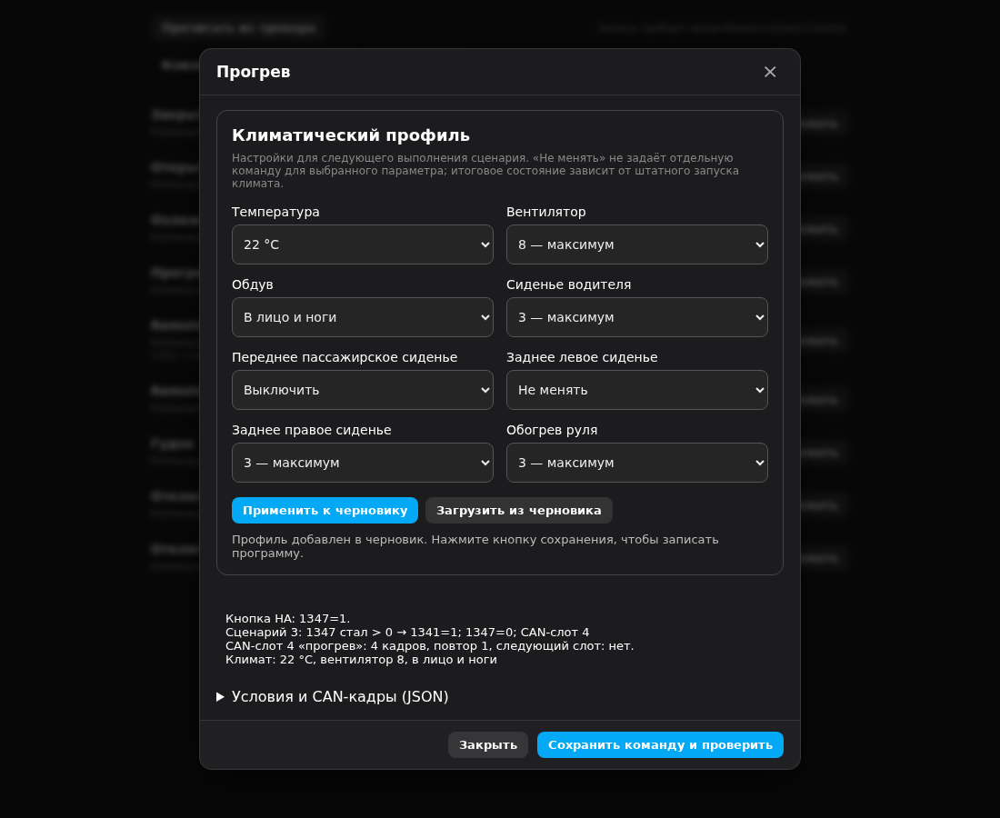

# Vega MT X CAN → Home Assistant

## Поддержать проект

<p align="center">
  <br>
  <sub>Если интеграция оказалась полезной — отсканируйте QR</sub>
</p>

---

Локальная, не зависящая от облака интеграция автомобильного трекера **Vega MT X CAN** (устанавливается на электромобили Evolute, Seres и др.). В отличие от облачного Evolute приложения, этот компонент поднимает **сырой TCP-слушатель прямо внутри Home Assistant**: трекер подключается на него напрямую, компонент декодирует телеметрию и показывает автомобиль как **отдельное устройство** с живыми датчиками и кнопками управления.

## Возможности

- **Телеметрия** (push): SoC и запас хода, напряжение 12 В АКБ, одометр, температуры (за бортом, в салоне, батарея, ОЖ, климат), скорость вентилятора климата, подогрев и вентиляция сидений, подогрев руля, положение и режим АКПП, ближний свет, запас хода на бензине, уровень GSM, скорость, геолокация (`device_tracker`), двери, багажник, центральный замок, зажигание, зарядка, online/moving и др.
- **Команды**: Кнопки команд с подтверждением нажатия (hold-to-confirm). После чтения CAN-скриптов появляются кнопки управления через виртуальные выходы (`SET_SETTING`, 134x); для отправки нужен `Direct Control`. Связь кнопок со слотами определяется прочитанными сценариями 4001, а не номером или названием слота. **Номер команды тоже берётся из сценариев трекера**: у заводских профилей разных автомобилей одни и те же скрипты запускаются разными номерами («в охрану» — 1349 на `ISpace_4wd` и 1346 на профилях i-Space 2025, где 1349 — это гудок). Кнопка ищет сценарий, который запускает её скрипт (слоты 0 — в охрану, 1 — с охраны, 2 — охлаждение, 4 — прогрев, 7 — гудок), и шлёт его номер. Если такого сценария нет или привычный номер занят другой кнопкой, команда не отправляется, а кнопка сообщает причину. Сценарии для этого читаются с трекера в двух случаях: при первом включении **Direct Control** и по кнопке **«Прочитать из трекера»** в редакторе команд. Прочитанное сохраняется и переживает перезапуск Home Assistant; сама команда ничего не читает и не ждёт. Если профиль трекера меняли вне Home Assistant, нажмите «Прочитать из трекера» — иначе кнопки будут слать номера прежнего профиля. Пока сценарии не прочитаны или после неподтверждённой записи сценария кнопки не отправляют ничего и просят прочитать трекер. При обновлении с версии, где Direct Control уже включён, сценарии читаются один раз после запуска.
- **Редактор команд**: чтение сценариев (Setting 4001) и CAN-слотов (5502), изменение условий, действий внешних выходов и связанных CAN-кадров прямо из Home Assistant.
- **Режимы работы**: по умолчанию работает в режиме `proxy` (ретранслирует трафик в облако Evolute, родное приложение остаётся онлайн). Можно включить `Direct Mode` после подключения в proxy-режиме и по желанию отключить проксирование на облако Evolute (переключатели `Proxy Mode` и `Direct Control`).

## Мгновенная мощность ВВБ на F515

Сущности `sensor.vega_<IMEI>_hv_battery_voltage`, `..._hv_battery_current` и `..._hv_battery_power` показывают напряжение в В, ток в А и мощность в кВт. Мощность рассчитывается как `U × I / 1000`: положительное значение — разряд батареи, отрицательное — поступление энергии в батарею при зарядке или рекуперации. Источник — два пользовательских CAN-датчика самого трекера; ГУ и Vega Monitor для передачи в HA не нужны.

Для нового трекера откройте **Настройки → Устройства и службы → Устройства → Vega → Настройки Vega** (ссылка конфигурации устройства, также доступна по `/vega-config`). В блоке **«Мощность ВВБ»** выберите профиль автомобиля — **F515 / i-Space 4WD** или **i-Space 2025**, нажмите **«Проверить настройки»**, затем **«Настроить измерение мощности ВВБ»**. Проверка только читает конфигурацию; запись начинается по отдельному нажатию. Для проверки нужно авторизованное соединение Vega Binary, для записи дополнительно включите **Direct Control** на странице устройства. Соединения только через Combine для настройки недостаточно.

Интеграция читает все 128 слотов CAN и 6 групп ISO-TP, проверяет профиль по существующему датчику SoC и выбирает свободные слоты на той же шине. Идентификаторы 2922/2923 проверяются на конфликты; чужие датчики не перезаписываются. Уже настроенные датчики распознаются, повторная запись не требуется. После частичного результата новая проверка определяет оставшиеся изменения. Показания напряжения, тока и мощности отображаются в том же блоке с учётом переименованных сущностей HA. У других автомобилей формат CAN-сигналов может отличаться; пока доступен только указанный профиль.

Профиль **i-Space 2025** (трекеры с CAN-профилем `ISpace_11092025`) добавлен по сравнению настроек: декодер SoC у него побайтно совпадает с F515 / i-Space 4WD, поэтому напряжение и ток читаются из того же кадра CAN. **На автомобиле этот профиль не проверялся** — после настройки сверьте напряжение ВВБ с показаниями автомобиля. Редактор климата для него недоступен.

Перед записью повторно проверяется полный снимок конфигурации. Исходные данные и журнал записей сохраняются в `config/vega/hv_battery_backups_<IMEI>.jsonl`. Каждая изменённая запись отправляется один раз и проверяется обратным чтением. При ошибке дальнейшая запись прекращается, показываются подтверждённые изменения и возможная неподтверждённая запись. Автоматического отката нет; для восстановления сохранены исходные байты. Открытие страницы и загрузка интеграции настройки трекера не изменяют.

Сервисы `vega.prepare_hv_battery` (`profile: f515_ispace_4wd` или `ispace_2025`) и `vega.configure_hv_battery` (`plan_id` из ответа проверки) требуют получения ответа. При нескольких интеграциях обязателен `entry_id`. План привязан к трекеру, действует 15 минут и используется один раз; после перезапуска HA нужно проверить настройки заново.

| Параметр | Напряжение ВВБ | Ток ВВБ |
| --- | --- | --- |
| Vega sensor ID | 2922 | 2923 |
| Тип значения | FLOAT32 | FLOAT32 |
| CAN ID | `0x104` | `0x104` |
| Младший бит поля, байты/биты с нуля | байт 1, бит 2 | байт 5, бит 6 |
| Длина | 14 бит | 14 бит |
| Порядок байт | big endian | big endian |
| Пересчёт | `raw × 0.1` | `raw × 0.1 − 400` |

Выбирается та же CAN-шина, с которой уже читается SoC из `0x104`. В проверенной конфигурации датчики заняли свободные `5500/48` и `5500/49`. Для обоих включена периодическая запись каждые 5 секунд: `3004/2922` и `3004/2923` = `00050000` (с треком — нет; период — uint16 LE; порог изменения — 0). Это обеспечивает обновление обоих значений и при постоянной нагрузке. Доставка пакетов в HA зависит также от интервала связи сервера. Таймер сброса при отсутствии CAN-кадра установлен в 15 секунд, значение сброса — 0. Нулевое напряжение не считается рабочим показанием. Настройки сохраняются с проверкой обратным чтением; исходные записи нужны для отката.

Поддерживаются Wialon Combine и опрос по Vega Binary. Значения уже пересчитаны трекером: повторно применять коэффициенты в HA не нужно. Расчёт использует два значения одного транспорта с разницей времени не более 5 секунд. Через 90 секунд без свежих измерений соответствующие сущности становятся недоступными; keep-alive трекера и повторная доставка старых Combine-пакетов этот срок не продлевают. Частота обновления зависит от настроек передачи трекера, а при бинарном опросе — от интервала интеграции. Это мощность в момент измерения, не энергия в кВт·ч и не расход на 100 км.

Проверка 02.11.2026: расшифровка сопоставлена с 764 архивными измерениями Android VHAL (371.4–390.9 В, −7.7…0 А) и проверена текущим чтением трекера при разряде. Например, 361.9 В × 2.6 А = 0.941 кВт после округления. Небольшой разброс между независимыми замерами связан с разным временем чтения.

## Сетевая настройка (NAT / Проброс портов)

По умолчанию Home Assistant начинает слушать входящие подключения на TCP-порту **`21443`**.

Для работы интеграции необходимо настроить **NAT / Port Forwarding** (проброс портов) на вашем роутере (или обратный SSH/VPN-туннель с внешнего белого IP-адреса), чтобы входящие TCP-подключения из интернета от трекера перенаправлялись на порт `21443` вашего сервера Home Assistant.

## Установка

### Через HACS (рекомендуется)

1. Откройте **HACS → Интеграции**.
2. В правом верхнем углу нажмите **три точки ⋮ → Пользовательские репозитории** (Custom repositories).
3. Добавьте URL репозитория:
   ```
   https://github.com/dsultanr/vega-ha-integration
   ```
   Тип: **Интеграция** (Integration) → нажмите **Добавить**.
4. Найдите интеграцию **Vega MT X CAN** в поиске и нажмите **Скачать** (Download).
5. **Обязательно перезагрузите Home Assistant** после установки!
6. Перейдите в **Настройки → Устройства и службы → Добавить интеграцию → Vega**.

### Вручную

Скопируйте директорию `custom_components/vega/` в папку `config/custom_components/` вашего Home Assistant и **перезагрузите Home Assistant**.

---

## Настройка трекера

Чтобы трекер передавал данные в Home Assistant, необходимо изменить адрес сервера в его настройках.

### 1. Скачивание конфигуратора
Скачайте официальную программу **Vega MT Configurator**:
- **Для Windows**: с официального сайта [Вега-Абсолют (Центр загрузок)](https://vega-absolute.ru/) или со страницы продукта [Vega MT X CAN](https://vega-absolute.ru/catalog/product/vega-mt-x-can) (раздел «ПО и документация»).
- **Для Android**: приложение **Vega MT Configurator** доступно в Google Play, а также в виде установочного APK на сайте производителя.

### 2. Подключение к трекеру
Подключитесь к блоку трекера удобным способом:
- через кабель **mini-USB** (напрямую к блоку трекера);
- по **Bluetooth** (если включен в трекере);
- либо удалённо через SMS/сервер.

### 3. Изменение адреса сервера
1. В конфигураторе перейдите в раздел **Настройки серверов** (Setting 3001).
2. Для электромобилей **Evolute** рекомендуется менять **Сервер 4** (Слот 4 / Setting 3001, sub_id 3, заводской адрес `telemetry.evassist.ru:21124`).
3. Укажите:
   - **Адрес / IP**: внешний белый IP-адрес или доменное имя вашего роутера/Home Assistant.
   - **Порт**: `21443` (или порт, указанный вами при настройке интеграции в HA).
   - **Протокол**: `0x03 (Vega Binary)`.
4. Нажмите кнопку **«Применить» / «Записать в устройство»**.

После применения настроек трекер подключится к вашему Home Assistant.

---

## Структура репозитория

- `custom_components/vega/` — интеграция для Home Assistant (включая чистый stdlib `protocol.py` без сторонних зависимостей).
- `examples/vega-car-view.yaml` — пример дашборда Lovelace (кнопки с зажатием, телеметрия и карта).
- `tests/` — тесты протокола, редактора и записи с имитатором трекера (см. ниже).

## Редактор команд и CAN-скриптов

Откройте **Настройки → Устройства и службы → Устройства → Vega** и нажмите ссылку конфигурации устройства (название кнопки зависит от языка HA). Она ведёт на отдельную страницу **«Настройки Vega»** внутри Home Assistant с настройкой ВВБ и редактором команд и сценариев. Страница доступна администраторам, автоматически выбирает нужный трекер и содержит ссылку «К устройству». Добавлять карточку на dashboard или пункт в боковое меню не требуется.

Для быстрого доступа в примере dashboard под кнопками управления есть ссылка **«Команды и сценарии»** на универсальный адрес `/vega-config`. Если настроен один трекер, его редактор откроется сразу; если несколько — появится выбор. Отключённые и ещё не подключившиеся интеграции также учитываются, чтобы не выбирать другой трекер автоматически. Ссылку не нужно менять при новой установке HA. Это штатная строка `weblink`: она открывает редактор в той же вкладке, без отправки команды трекеру.

Редактор читает восемь слотов **0–7** настройки 5502 и 25 сценариев **0–24** настройки 4001. Нажмите **«Прочитать из трекера»**, затем **«Редактировать»** у нужной команды. Вкладки «Команды», «Все сценарии» и «CAN-слоты» позволяют открыть связанные настройки вместе или отдельный сценарий/слот. После перезапуска HA сценарии нужно перечитать; при неполном чтении привязки считаются неизвестными.

Прямая ссылка на конкретный трекер — `/vega-config/<entry_id>` — также работает и используется в `configuration_url` устройства. Она привязана к экземпляру интеграции в этой установке HA. Выбор сенсора идёт через реестр сущностей HA, поэтому его можно переименовать. При отсутствующем или отключённом сенсоре страница сообщает об этом и не переключается на другой трекер. Открытие страницы само по себе не отправляет запросов трекеру. Существующая карточка `custom:vega-can-editor` также поддерживается; после перехода на отдельную страницу её можно удалить с dashboard.

Для распознанных климатических программ F515 («Прогрев», «Охлаждение» и аналогичных) над JSON появляется **«Климатический профиль»**:

- температура: LO, 17,5–31,5 °C с шагом 0,5 и HI;
- вентилятор: скорости 1–8;
- обдув: в лицо; в лицо и ноги; в ноги; в ноги и на лобовое стекло;
- обогрев каждого из четырёх сидений и руля отдельно: выключен, уровни 1–3;
- «Не менять» для вентилятора, обдува и обогревов: отдельная команда для параметра не задаётся. Итог зависит также от штатного запуска климата.



**Форма проверена только на одном автомобиле: F515 / i-Space 4WD с прошивкой трекера `VEGA MT X CAN LTE v5 0.10b rc41.56 'ISp4WD'`.** На других комплектациях и прошивках CAN-команды могут отличаться, поэтому форма заблокирована, пока не пройдена проверка: выберите профиль автомобиля и нажмите **«Проверить совместимость»**. Интеграция читает версию прошивки трекера и его CAN-декодеры (настройка 5500) и сверяет их с проверенным автомобилем — так же, как при настройке мощности ВВБ. Проверка ничего не записывает в трекер, её результат запоминается; при другой прошивке или несовпадении декодеров форма остаётся недоступной. Ручная правка JSON от проверки не зависит. Для проверки нужно соединение Vega Binary; сервис — `vega.check_climate_profile`.

Выберите параметры, нажмите **«Применить к черновику»**, затем **«Сохранить команду и проверить»**. Изменения формы не отправляются автомобилю до сохранения; неприменённые значения блокируют сохранение, чтобы не записать старый черновик. «Загрузить из черновика» возвращает значения из JSON. Если команда использует несколько климатических программ, выберите нужную в форме. Условия запуска, действия выходов и остальные программы при этом сохраняются. Связи общего CAN-слота с другими сценариями показаны в описании команды.

Форма собирает четыре строки в одном CAN-слоте: исходная команда BCM с выбранными передними обогревами, снятие импульса, явные настройки HVAC, задние обогревы и руль. Задержки строк — 5000, 10000, 1000 и 150 мс, число отправок — 2, 1, 2 и 3. Первая строка отправляется сразу: повтор команды BCM через 5 секунд предназначен для блока, который ещё просыпается при первом запросе. Температура задаётся в командах BCM и HVAC; имя и повтор программы сохраняются. Программы с неизвестными командами, цепочкой слотов или неоднозначной последовательностью остаются в JSON-редакторе.

Команды сопоставлены с управлением штатного HVAC. Прямая отправка последовательности на бодрствующем автомобиле подтвердила температуру, вентилятор, обдув, передние обогревы, задний правый обогрев и руль; уровни заднего левого проверены отдельно через штатный HVAC. Исполнение сохранённой программы прошивкой Vega проверено на бодрствующем автомобиле: все семь параметров профиля 22 °C / скорость 8 / лицо и ноги подтверждены телеметрией и повторным чтением. Проверка запуска через существующий сценарий после выключения автомобиля подтвердила пробуждение. Независимый pull по облачному каналу S4 во время работы подтвердил 22 °C, максимальные обогревы водителя, заднего правого сиденья и руля, выключенный обогрев переднего пассажира. Полный профиль после сна пока не подтверждён: в контрольном запуске 15 ноября (МСК) скорость кратко достигла 8, затем датчик Auto 2905 стал равен 1 и скорость снизилась до 3–4; обдув также не удержался в положении «лицо и ноги». Отдельная команда вентилятора, исключение температуры из кадра и повторные запросы после пробуждения проблему не решили. Источник повторного включения Auto и точный порядок передачи кадров ещё не установлены. Pull не требует UI или USB ГУ, но время ответа трекера не является временем последнего CAN-кадра. Перед командами управления плотный диагностический опрос прекращается, чтобы освободить общий канал. Температура задаётся общим полем; независимое управление температурой пассажирской зоны не заявляется.

Дополнительная проверка 15 ноября: отдельный запрос скорости 8 через CAN после установления дистанционного режима не снял Auto и не изменил наблюдаемую скорость 4. Доставка CAN по тому же каналу подтверждена контрольным переключением обогрева руля 3 → 2 → 3. Это не доказывает невозможность ручного режима: штатный способ выхода из Auto при Remote ещё не установлен. CAN можно записывать через S4 без ГУ, но поток имеет паузы, а отражение собственной передачи Vega в RX не подтверждено.

Документ команды содержит `scenarios` и `scripts`. Для каждого сценария редактируются:

- `index`: номер существующего сценария 0–24. Кнопка «Добавить сценарий для этой команды» выбирает свободную запись и подставляет условие команды HA.
- `conditions`: два условия или `null`. Условие содержит `sensor` (1–65535), `comparison` (`equal` — стал равен, `greater` — стал больше, `changed` — любое изменение) и числовой `value`. `match`: `any` (ИЛИ) или `all` (И).
- `actions.external_output_on` / `external_output_off`: номер внешнего выхода 1–15, либо 0 — действие не выбрано. ID выхода равен 1340 + номер. Поля `*_seconds` задают время 0–255 с, как в конфигураторе.
- `actions.can_script`: номер CAN-слота 0–7 или `null`.

Например, прочитанный сценарий прогрева содержит условие `1347 > 0`, включение внешнего выхода 1 (`1341=1`), сброс выхода 7 (`1347=0`) и CAN-слот 4. Редактор показывает их вместе. Порядок полей JSON не задаёт порядок выполнения действий прошивкой. Для отключения сценария укажите `conditions: [null, null]`, сохранив запись в документе.

Другие действия сценария (SMS, звонки, физические выходы и встроенные действия автомобиля) пока не редактируются: их байты сохраняются без изменений, а интерфейс сообщает об их наличии. Неизвестный формат нельзя перезаписать. При редактировании общего CAN-слота показываются другие сценарии, использующие его.

Имя `RemoteOn` в слоте 5 само по себе не связывает слот с кнопкой Remote On. Кнопка HA управляет выходом 1341; её программный импульс 0 → пауза → 1 реализован интеграцией и не хранится в 4001/5502. Редактор показывает настройки, реально прочитанные из трекера, включая сценарии без CAN-слотов. Расшифровка CAN-кадров — подсказка, которая не подтверждает физический результат команды.

CAN-скрипт содержит `format_version`, `name`, `repeat`, `frame_type`, `chain_next`, `frames`, а внутри документа команды — ещё и `slot`. Допускаются имя до 16 байт Windows-1251, повтор 0–255 и до четырёх кадров. Диапазоны полей версии 2 приведены ниже. Неверные значения отклоняются без отправки в трекер. Если исходные 82 байта нельзя воспроизвести без потерь, слот доступен только для просмотра.

Перед сохранением команды интеграция проверяет весь документ, перечитывает исходные настройки для обнаружения конфликтов и сохраняет резервную копию в `config/vega/command_backups_<IMEI>.jsonl`. Записываются только изменённые записи: сначала CAN-слоты, затем сценарии. Каждая запись отправляется один раз и проверяется обратным чтением всех байт. Несколько записей не являются атомарной транзакцией: при ошибке дальнейшие записи прекращаются, сообщение перечисляет подтверждённые изменения и возможную неподтверждённую запись. Автоматического отката и повторной отправки нет. Черновик сохраняется при ошибке и обновлениях телеметрии. Перед повторным сохранением после частичного результата перечитайте настройки и откройте новый черновик.

Сервисы `vega.read_commands` и `vega.write_commands` поддерживают ответ. Для записи нужны `document` и `expected`: словарь исходных HEX-строк с ключами `4001/3`, `5502/4` и т. п. Карточка передаёт снимок всех 33 записей для обнаружения изменений общих связей. При нескольких интеграциях обязателен `entry_id`; карточка выбирает трекер автоматически. Запись требует включённого `Direct Control`.

Сервисы `vega.read_can_scripts` и `vega.write_can_script` также доступны. При отдельной записи слота его исходные байты сохраняются в `config/vega/can_script_backups_<IMEI>.jsonl`; для обнаружения конфликта передавайте `expected_raw`. Сохранение настроек не отправляет команду запуска CAN-скрипта.

### Резервные копии сценариев

Кнопка **«Резервные копии»** в редакторе открывает список сохранённых копий. **«Сохранить копию из трекера»** читает все 25 сценариев и 8 CAN-слотов и сохраняет их байт в байт в `config/vega/command_snapshots_<IMEI>/<дата>.json`; трекер при этом не изменяется. К копии можно добавить примечание.

**«Восстановить»** (с подтверждением) записывает в трекер только те записи, которые отличаются от копии: сначала CAN-слоты, затем сценарии. Каждая запись отправляется один раз и проверяется обратным чтением; при ошибке оставшиеся записи не отправляются, а сообщение перечисляет подтверждённые. Перед записью текущее состояние автоматически сохраняется отдельной копией, поэтому восстановление можно отменить. Нужен Direct Control. Копию другого трекера восстановить нельзя. Восстановление не запускает команды автомобиля. Копии автоматически не удаляются.

Сервисы: `vega.backup_commands` (необязательное `note`), `vega.list_command_backups`, `vega.restore_commands` (`backup_id`).

### Формат CAN-программы

Новые документы используют `format_version: 2`. После обновления перечитайте программы из трекера; JSON старого редактора не принимается, поскольку он неверно трактовал шину, задержку и число отправок.

- `bus`: CAN1–CAN3, значения 1–3.
- `delay_ms`: 0–10230 мс с шагом 10 мс.
- `count`: число отправок строки, 0–255; независимо от шины. Нулевое значение сохраняется как прочитано, без предположений о поведении прошивки.
- `dlc`: длина передаваемых данных, 0–8. `data` содержит все 8 байт хранения строки — ровно 16 HEX-символов.
- `frame_type`: 1 — стандартный ID, 2 — расширенный ID.
- `repeat`: повтор всей программы, 0–255; `chain_next`: переход к следующему слоту, `true`/`false`.

Редактор сохраняет строки с нулевым `count`, показывает его отдельно и не разрешает запись, если исходный формат нельзя восстановить байт в байт. Данные старого кэша повторно расшифровываются из `raw`; запись доступна только после чтения трекера.

### Дополнительные датчики климата F515

При настроенных пассивных декодерах Vega доступны:

| ID | Сущность | Значения |
|---|---|---|
| 2924 | `seat_heater_rear_right` | 0 — выключен, 1–3 — уровень подогрева |
| 2925 | `climate_air_distribution` | Проверены 1 — в лицо, 2 — в лицо и ноги, 3 — в ноги; прочие коды не расшифрованы |

Обновление интеграции **не записывает декодеры и не меняет Preheat автоматически**. Планировщик `tools/prepare_climate_sensors.py` проверяет полный снимок 5500/5503, занятость ID и свободные слоты; выдаёт исходные и новые байты без подключения к машине. Профиль включает период 5 секунд и сброс в 255 после 15 секунд без CAN-кадра. В HA значение сброса и недопустимые уровни сиденья отображаются как недоступные, а не как выключенный обогрев. Доставка сообщений зависит также от интервала связи трекера.

Сервис `vega.read_sensors` запрашивает выбранные ID через существующее соединение, возвращая значения, время запросов/ответов и ошибки. Например, `sensor_ids: [2906, 2907, 2912, 2913, 2918, 2924, 2925]`, `timeout: 2`. При нескольких трекерах нужен `entry_id`. Чтение не требует Direct Control. Новый ответ подтверждает связь с Vega, но сам по себе не устанавливает время исходного CAN-измерения.

Существующий датчик 2905 «Климат Auto» доступен как `binary_sensor.vega_<IMEI>_climate_auto` и включён в стандартный набор `vega.read_sensors`. До получения значения он недоступен; добавление сущности не меняет настройки трекера.

`tools/preheat_profile.json` содержит подготовленный профиль 22°C, в лицо и ноги, вентилятор максимум, водитель/заднее правое сиденье/руль — максимум, передний пассажир — выключен. Сохранённая программа выполняется, запуск после выключения автомобиля проверен; полный профиль после сна остаётся неподтверждённым из-за Auto, скорости и обдува. Скрипт наблюдения `tools/preheat_watch.py` сохраняет показания и результаты pull без запуска автомобиля.

### Проверки без автомобиля

Нужны Python 3.11+ и Node.js 18+.

```sh
python3.11 -B tests/test_protocol.py
python3.11 -B tests/test_hv_battery.py
python3.11 -B tests/test_hv_setup.py
python3.11 -B tests/test_combine.py
python3.11 -B tests/test_can_config.py
python3.11 -B tests/test_commands.py
python3.11 -B tests/test_can_native.py
python3.11 -B tests/test_climate_profile.py
python3.11 -B tests/test_sensor_pull.py
python3.11 -B tests/test_command_backups.py
node --test tests/test_can_editor.cjs
```

`test_can_config.py` и `test_commands.py` используют архивные бинарные настройки и имитатор транспорта: проверяют сохранение непрозрачных полей, конфликты, частичную запись, потерю ACK, таймауты и отмену операции. Тесты сервисов `python3 -B tests/test_can_services.py` запускаются в окружении с установленным Home Assistant.

Дополнительно `node tests/test_command_browser.cjs` проверяет интерфейс в Chromium, включая мобильное окно и сохранение черновика после ошибки. `node tests/test_config_panel_browser.cjs` проверяет отдельную страницу: прямое открытие, переименование сущности, выбор трекера, смену маршрута и недоступные данные. `node tests/test_hv_setup_browser.cjs` проверяет настройку ВВБ, выбор профиля, Direct Control, ошибки и повторное нажатие кнопки. Нужны пакет Playwright, его Chromium и Python 3.11+ (`PYTHON` позволяет указать интерпретатор). Используются архивные настройки и имитация HA без подключения к трекеру.

## Дисклеймер

Протоколы взаимодействия исследованы и реализованы методом реверс-инжиниринга; проект не является официальным продуктом компании Вега-Абсолют или Evolute. Команды отправляются напрямую в блоки управления автомобиля — используйте на свой страх и риск. По умолчанию прямое управление выключено (`Direct Control` off).

## Лицензия

MIT © 2026 dsultanr

### Сырой захват облачного соединения

В режиме Vega proxy полученные TCP-данные обоих направлений сохраняются в
`/config/vega_rawcap/` до пересылки и независимо от распознавания протокола.
Каждая сессия получает уникальное имя, JSONL-файлы разделяются на части по 16 МиБ.
Запись содержит `session`, `seq`, `received_ns`, `direction` (`c2t` / `t2c`),
`length` и `base64`. Чтобы восстановить поток, объедините декодированные данные
одного направления в порядке `seq` внутри одной сессии. Границы записей — границы
чтения TCP, а не пакетов Vega. Начальные байты соединения также сохраняются.

Запись и `fsync` выполняются в executor до передачи фрагмента дальше. При ошибке
записи связь продолжает работать, а журнал и постоянное уведомление HA сообщают
о неполном захвате. Файлы создаются с правами 0600, каталог — 0700: трафик может
содержать авторизацию и телеметрию. Автоматического удаления нет; необходимо
контролировать свободное место. Отдельный распознанный файловый захват
`vega_filecap` сохраняется. Потоки через другие серверы, TLS и Wialon Combine
этим захватом Vega proxy не записываются.

Действие `vega.read_server_slots` возвращает текущие адреса, протоколы и периоды
четырёх серверных слотов, прочитанных из Setting 3001 sub0..3. Оно не меняет
настройки и не возвращает PIN-коды; при нескольких интеграциях укажите `entry_id`.
